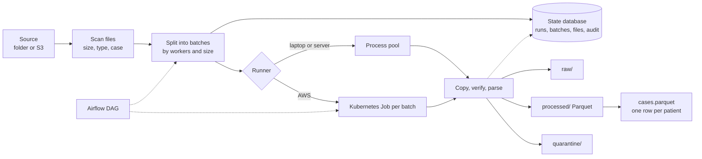

# Pipeline For Large Scale Multimodal Data To Move From One Place To Another

`ingestkit` moves lab data from one place to another: whole slide images, VCF genomics files and clinical records. The source and the destination can each be a local folder or an S3 bucket.

On the way, every file is checksummed, verified, parsed into a clean table and linked to its patient case. Every step is written to a state database, so you can trace any output back to the exact source file, and a run that crashes can resume where it stopped.

I built it around a medical AI problem. Slide images are huge, genomics and clinical files are tiny, and all three have to end up correctly matched per patient with a full audit trail.

## Tech stack

| Area | Tools |
| --- | --- |
| Language | Python 3.11+ |
| Orchestration | Apache Airflow 3 |
| Containers | Docker, Kubernetes (one Job per batch) |
| Cloud | AWS S3, EKS, RDS Postgres, ECR, IAM, KMS |
| Infrastructure as code | Terraform |
| State and logs | SQLAlchemy with SQLite locally, Postgres in the cloud |
| Data formats | Parquet (pyarrow), TIFF/SVS slides (tiffslide), VCF, JSON, CSV |
| Config | YAML validated with pydantic |
| Testing and CI | pytest, moto for S3, ruff, GitHub Actions |
| Local cloud | docker compose with Postgres and MinIO |

## How it works



A run goes like this:

1. Scan the source and list every file with its size, type and case ID.
2. Skip files that earlier runs already handled.
3. Count the workers: CPU cores (capped by `max_workers`) on one machine, or `max_parallel_jobs` on Kubernetes.
4. Split the files into at least one batch per worker, plus more if the data is bigger than `batch_size_gb` per batch. The largest files go first, each into the lightest batch, so every worker gets about the same amount of data.
5. Each worker handles its batch one file at a time:
   - Stream the file into `staging/` and compute its SHA-256 on the way.
   - Read the copy back and compare checksums.
   - Parse it. Slides give metadata, VCFs give filtered variants, and clinical records lose names and birth dates and get a keyed pseudonym.
   - Write the Parquet table to `processed/`.
   - Move the copy to `raw/`, named by its checksum.
6. Every batch saves its file statuses and audit events to the state database in one transaction.
7. At the end, the files are linked per patient (slide + VCF + clinical) into `cases.parquet`, with one yes/no column per panel gene.

Broken files go to `quarantine/` with the reason, so they never block the run.

## Quickstart

```bash
python -m venv .venv && source .venv/bin/activate
make install
export INGESTKIT_PSEUDONYM_SALT="any-long-random-secret"

make sample-data          # 20 synthetic cases plus 3 broken files
ingestkit plan            # file count, size, workers and batches
ingestkit run             # move, verify, parse, link
ingestkit status          # what happened in the latest run
ingestkit trace --path processed/slide/C-0001_<checksum>.parquet
```

You can stop a run halfway (Ctrl+C or `kill -9`) and continue with `ingestkit resume --run-id <run_id>`. Only unfinished batches run again, and nothing gets duplicated.

To try it with S3 instead of folders, run `make dev-up`. That starts MinIO and Postgres. Copy `.env.example` to `.env`, then set `source_path: s3://ingestkit-landing-zone/lab_upload` and `destination_path: s3://ingestkit-destination`.

## Where it runs

| Where | Setting | How batches run |
| --- | --- | --- |
| Laptop or one lab server | `runner_type: local` | Process pool, one worker per core up to `max_workers` |
| AWS EKS | `runner_type: kubernetes` | One Kubernetes Job per batch from `kubernetes/worker_job.yaml`. Each pod runs `ingestkit worker` and writes its own result to Postgres |
| On a schedule | Airflow | `airflow_dags/transfer_pipeline_dag.py`: `create_run`, then one mapped `transfer_batch` task per batch, then `complete_run` |

`terraform/` creates the AWS side: the S3 buckets, the EKS cluster, RDS Postgres for the state database, ECR for the worker image, the IAM role the worker pods use, and a KMS key for encryption.

## Results

I measured these in a 2 core, 8 GB Linux sandbox. Your numbers will differ.

| Test | Result |
| --- | --- |
| 40 cases, 118 files, 2.0 GB | About 5 s end to end, split into two 1.0 GB batches |
| Broken files | 3 of 3 quarantined with a reason (empty VCF, missing clinical fields, unsupported type) |
| One 1.7 GB slide | 9.1 s, peak memory 144 MB |
| Killed with `kill -9` at random points, 3 times | Every resume finished. Only the batches in flight ran again, with no duplicates and no half written files |
| Second run on the same folder | 118 of 118 files skipped |
| Tests | 101 passing, plus the Airflow DAG test, which runs where Airflow is installed |

## Project layout

| Path | What is in it |
| --- | --- |
| `ingestkit/` | The package, one class per file |
| `airflow_dags/` | The Airflow DAG |
| `kubernetes/` | Job template, ConfigMap, ServiceAccount |
| `terraform/` | All AWS resources |
| `scripts/` | Synthetic data generator and a TCGA open access downloader |
| `tests/` | One test file per module, S3 tested with moto |
| `.github/workflows/` | Lint, tests, `terraform validate` and the Docker build on every push |
| `docs/design_decisions.md` | Why it is built this way |

## Limits

- The local runner and S3 storage are tested end to end. The Kubernetes runner is tested against a fake API, and the DAG was imported with Airflow 3.4. The Terraform is checked but has never been applied, so none of the cloud pieces have been deployed.
- It uses synthetic data only. `scripts/download_tcga_samples.py` can fetch real open access TCGA slides and clinical data, but TCGA genomics comes as MAF rather than VCF, so those cases arrive without genomics.
- It is a demo. It is not a certified medical device and has not been validated under IVDR or FDA rules.
